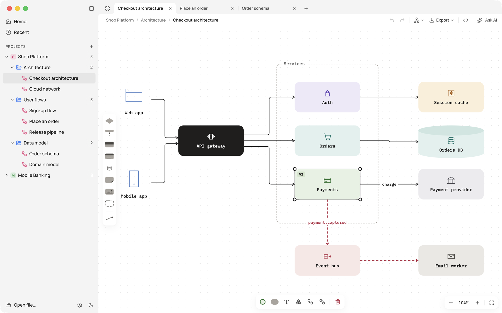
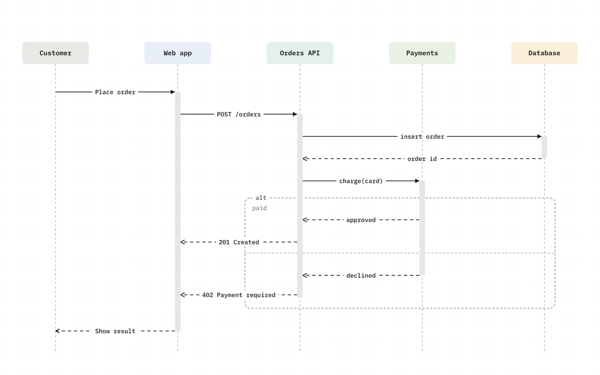
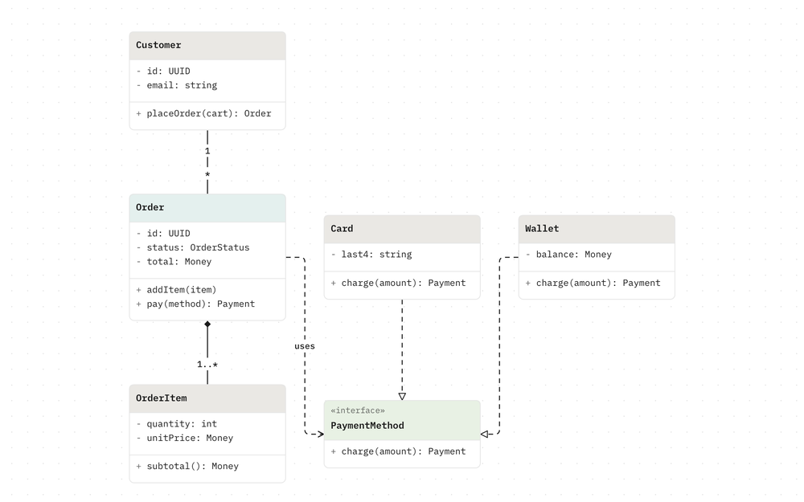
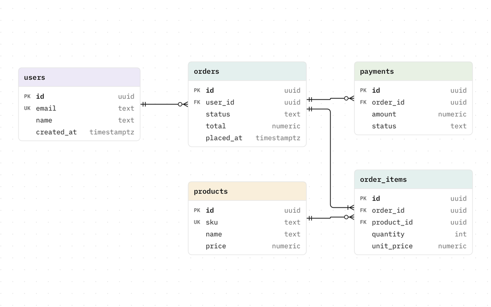
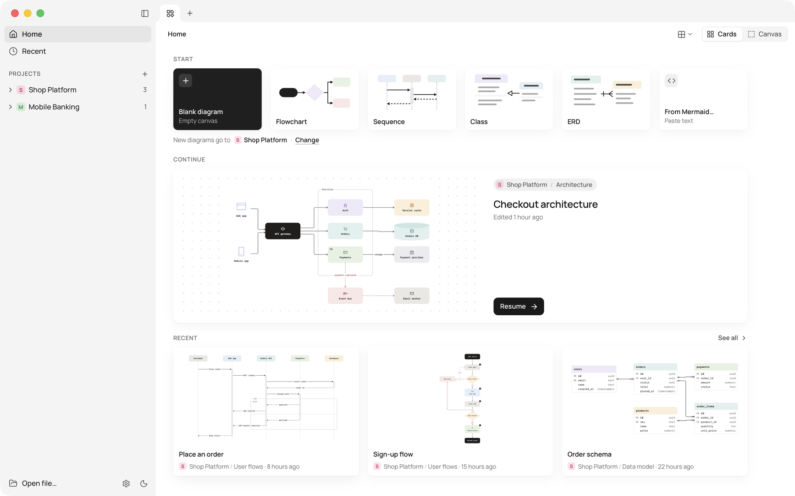
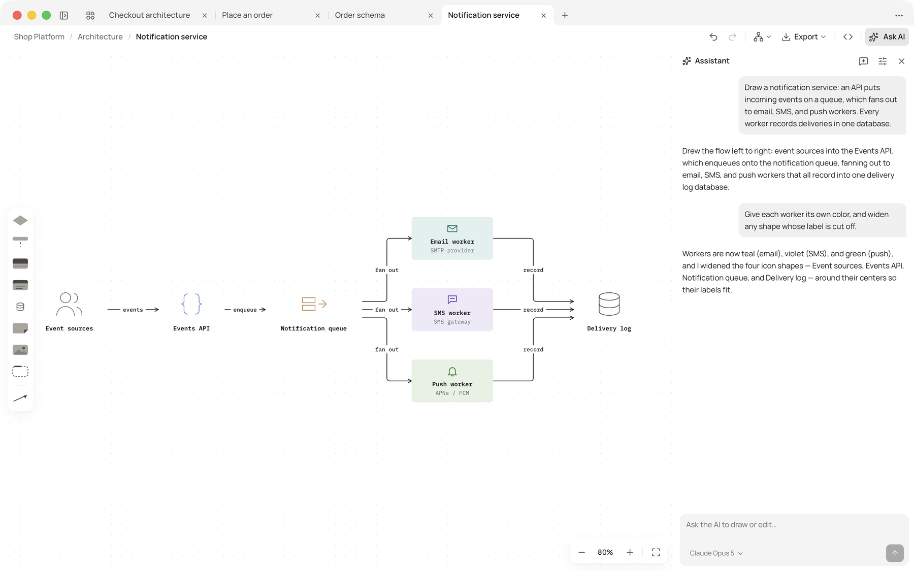
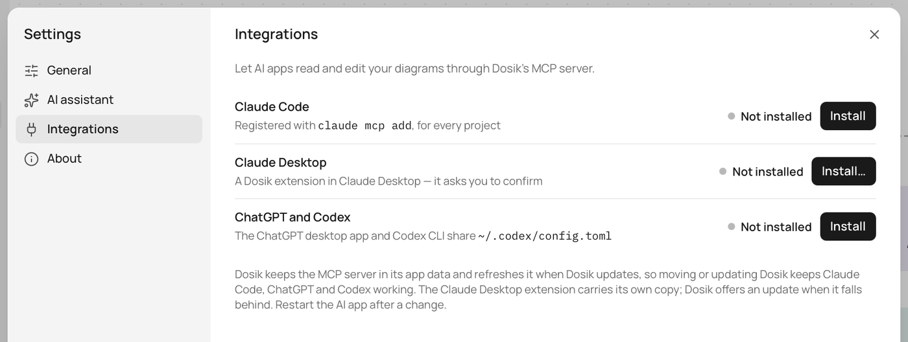
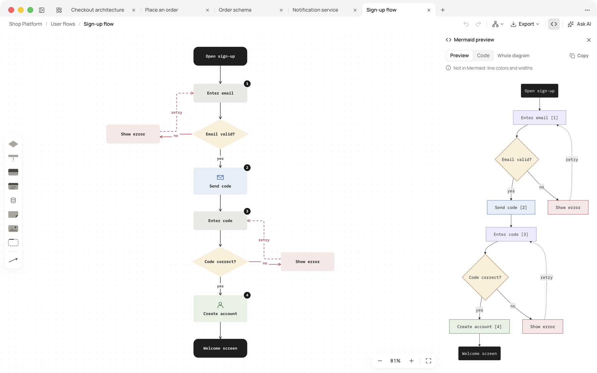
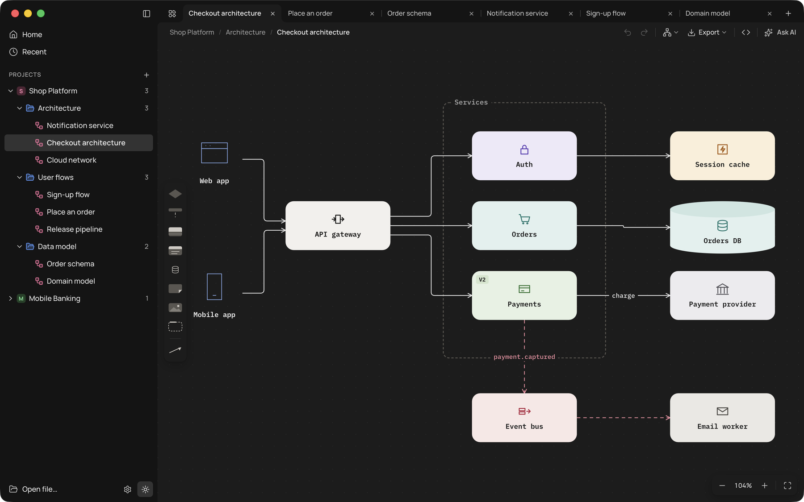

<h1 align="center">Dosik</h1>

  <b>Clean diagrams, drawn by you or by AI.</b> 
  Flowcharts, architecture, sequence, class, and ER diagrams in a calm desktop app for macOS.

  <a href="https://github.com/79841/dosik/releases/latest"><b>Download for macOS</b></a>

## Draw

Pick a shape from the bar on the left, drop it, and connect it. Connectors find their own path around other shapes, so a diagram stays tidy as it grows.

- **Shapes and icons** — boxes, diamonds, databases, sticky notes, frames, images, and 58 architecture icons
- **Nine soft colors**, tags, step numbers, and short descriptions on any shape
- **Auto layout** in four directions when you just want it arranged
- **Start from a template** on Home: Flowchart, Sequence, Class, ERD — or paste Mermaid

| Sequence | Class | ER |
|:---:|:---:|:---:|
|  |  |  |

## Stay organized

Everything you draw is saved as you go. Projects hold folders, folders hold diagrams, and each open diagram gets a tab. Home picks up where you left off.

## Ask AI to draw it

Click **Ask AI**, describe what you want in plain words, and watch it appear on the canvas. Keep talking to change it — "add a cache", "color the workers". Select shapes first to point the AI at them.

Choose Claude or GPT in **Settings ▸ AI assistant** (⌘,). Each can connect two ways:

| | Subscription — no API key | API key — pay per use |
|---|---|---|
| **Claude** | Your Claude plan, through [Claude Code](https://claude.com/claude-code) signed in on this Mac | An Anthropic API key |
| **GPT** | Your ChatGPT plan, through the Codex CLI signed in on this Mac | An OpenAI API key |

API keys are kept in the macOS Keychain.

## Use Dosik from Claude and ChatGPT

Already working in Claude or ChatGPT? Let them draw in Dosik directly.

1. Open **Settings ▸ Integrations** and click **Install** next to your AI app.
2. Restart that app.
3. Ask for a diagram.

| App | What you get |
|---|---|
| **Claude Desktop** | Diagrams appear right in the conversation, and in Dosik when it's open |
| **Claude Code** | Draws on the canvas open in Dosik, or reads and writes `.dosik.json` files in your project |
| **ChatGPT desktop and Codex** | The same tools as Claude Code |

Try:

> Draw our sign-up flow in Dosik: email, verification code, then the welcome screen.

> Look at the diagram open in Dosik and add a cache in front of the database.

> Export `docs/architecture.dosik.json` to Markdown.

Claude Code and Codex need Node.js 18 or later; the Claude Desktop extension brings its own.

## Share it anywhere

- **Export ▾** in the toolbar: Markdown (Mermaid), PNG, or SVG — save a file or copy to the clipboard. Right-click shapes to export just those
- **Paste Mermaid** with ⌘V and it becomes shapes you can edit
- **Mermaid preview** (`<>` in the toolbar) shows your diagram as Mermaid, side by side

## Light or dark

Follow macOS, or pick one in Settings ▸ General.

## Install

Download the `.dmg` for your Mac from [Releases](https://github.com/79841/dosik/releases/latest), open it, and drag Dosik to Applications.

| Mac | File |
|---|---|
| Apple silicon (M1 and later) | `Dosik_<version>_aarch64.dmg` |
| Intel | `Dosik_<version>_x64.dmg` |

- macOS 11 or later. Signed with Developer ID and notarized by Apple, so it opens normally
- Windows and Linux versions are not available yet
- Your diagrams are plain `.dosik.json` files on your Mac — Settings ▸ General shows where. Nothing leaves your Mac unless you use an AI feature
- Dosik doesn't show up in Finder's "Open With" yet; open files with **Open file…** in the sidebar

## Shortcuts

| Keys | Action |
|---|---|
| ⌘T / ⌘W | New diagram / close tab |
| ⌘1 · ⌘2–8 · ⌘9 | Library · diagram tabs · last tab |
| ⌘S · ⌘O | Save · open a file |
| ⌘Z / ⇧⌘Z | Undo / redo |
| ⌘C · ⌘X · ⌘D | Copy · cut · duplicate |
| ⌘G | Group shapes |
| ⌘V | Paste shapes, an image, or Mermaid code |
| ⌘\ · ⌘, | Sidebar · Settings |

## For developers

Building from source, the local agent API, and the MCP tools: [docs/DEVELOPMENT.md](docs/DEVELOPMENT.md).

## License

[MIT](LICENSE). Development happens in this repository; it does not take issues or pull requests.

The name comes from the Korean word *dosik* (圖式) — a picture of how things are structured and related.
